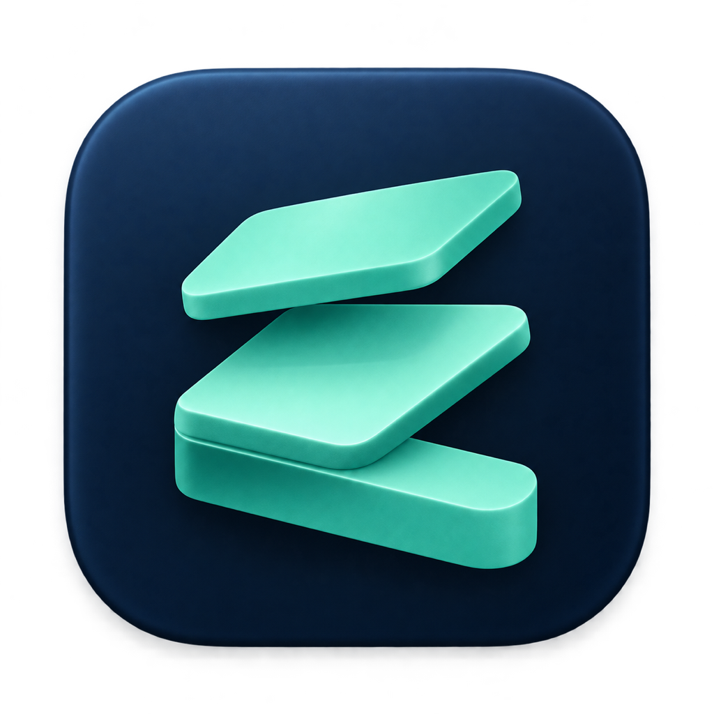

<p align="center">
  
</p>

<h1 align="center">Zen-ith</h1>

<p align="center">
  <strong>開発者のための macOS メニューバー常駐型 スマートキャッシュ＆ダウンロードクリーナー</strong><br />
  Xcode / Simulator / Android / Node.js / Python・AI / Docker / ワークスペース / ダウンロードフォルダを一括可視化・安全整理
</p>

---

## ✨ 特徴 (Features)

### 1. メニューバー常駐 ＆ Mac 空き容量・回復予測ゲージ
- Dock を占有しないメニューバー常駐型（`MenuBarExtra` / `LSUIElement`）。
- 現在の **Mac 空き容量 / 総容量** と、選択した項目を削除した後の **回復予測容量（`削除後: XX.X GB (+XX.X GB)`）** をリアルタイムゲージで表示します。

### 2. ダウンロードフォルダのインテリジェント整理 (`~/Downloads`, `~/Desktop`)
単なる「古いファイル削除」ではなく、システム状態を照合して本当に不要なファイルだけを特定します：
- **✅ インストール済インストーラー検出**: `.dmg` / `.pkg` のファイル名を `/Applications` および `~/Applications` のインストール済み `.app` と照合。削除時はマウント中の仮想ディスクも `/usr/bin/hdiutil detach` で自動アンマウントします。
- **📂 解凍済アーカイブ検出**: `.zip` / `.tar.gz` / `.tgz` と同名の展開済みフォルダが同一ディレクトリに存在するかを判定。
- **👯 3段階完全一致重複検出**: 命名パターン（`file (1).pdf`, `file copy.zip` 等）→ バイトサイズ完全一致 → **CryptoKit (`SHA256`) ハッシュ完全一致** の3段階検証で誤爆ゼロの重複検出を実現。

### 3. ワークスペース深層スキャン ＆ Docker CLI 連携
- **ワークスペース深層スキャン**: 登録した開発フォルダ（`~/dev`, `~/Projects` 等）配下の `node_modules`、`Pods`、`.venv` / `venv`、`.next`、`.nuxt`、`.turbo`、`target`、`build`、`.gradle`、`.terraform` などを高速列挙（`skipDescendants` によるネストスキップ最適化済）。`.git/index` や `package.json` の更新日時から「最終アクティブ日（N日前）」を算出します。
- **Docker 連携**: `docker system df` と連携し、未使用 Images・停止中 Containers・BuildKit Cache を安全に `docker prune`。データベース消失リスクのある `Local Volumes` は自動選択から保護し、`Docker.raw` 等の仮想ディスク肥大化も可視化します。

### 4. ✨ AI解説・質問アドバイザー（「これ消して大丈夫？」を即座に解決）
- 各行の **「✨ AI解説」** ボタンを押すと、0ms で「これは何か」「消すとどうなるか」「再生成コマンド」「実フォルダ内の内訳」をインライン表示。
- さらにフリーテキストやワンクリック質問チップから、ローカル CLI（**Antigravity CLI (`agy`)** / **Claude Code (`claude`)** / **ChatGPT・Codex CLI (`codex`)**）、ローカル LLM（**`Ollama`**）、または **`Gemini API`** / **`ChatGPT (OpenAI API)`** に直接質問できます。

### 5. 柔軟なフィルタ・検索・安全設計・スキップ診断
- **スマートフィルタ**: `✨ 推奨` / `すべて` / `30日以上` / `90日以上` のワンクリック切り替え。
- **インクリメンタル検索**: プロジェクト名・パス・Simulator の OS バージョン（例: `iOS 18.2`, `Android 14`, `node_modules`）で即座に絞り込み。
- **一括削除 ＆ 行ごとの単一削除**: チェックボックスによる一括クリーンアップに加え、各行のゴミ箱ボタンから1項目だけを即座に削除可能。
- **ハイブリッド削除モード**: ダウンロードファイルや `Xcode Archives` は「ゴミ箱」へ移動し、再生成可能な純粋キャッシュは高速に直接削除（すべてゴミ箱へ移動するセーフティモードも選択可）。
- **⚠️ 要確認バッジ保護**: `Xcode Archives`、Simulator 仮想端末、ローカル LLM モデル（Ollama / Hugging Face / LM Studio）、`Docker Local Volumes` などの重要データは自動一括選択から除外し、誤削除を防止します。
- **⛔ スキップ原因の自動診断 ＆ ワンクリック解決**:
  - 読み取り専用キャッシュ（`chmod -R u+w`）や Simulator 端末（`xcrun simctl delete`）は削除時に自動リカバリを実行。
  - `root` 権限で保護されたシステムキャッシュ（`CoreSimulator/Caches/dyld` 等）やプロセス使用中などでスキップされた項目は、**スキップされた具体的な理由と対処手順**をインライン表示し、**「🔒 管理者権限で削除 (Touch ID / パスワード)」**・**「コマンドをコピー」**・**「フルディスクアクセス設定を開く」** からその場で解決できます。

### 6. 自動化 ＆ Sparkle 2 オートアップデート
- バックグラウンド定期スキャン（毎日 / 3日ごと / 毎週）と、閾値（30GB / 50GB）超過時の macOS ネイティブ通知。
- `SMAppService` による Mac ログイン時の自動起動。
- **Sparkle 2** による GitHub Releases からの自動アップデート対応。

---

## 📂 スキャン対象カテゴリ一覧

| カテゴリ | 主な検出対象パス・リソース |
| :--- | :--- |
| **ダウンロード整理** | `~/Downloads`, `~/Desktop` 内のインストール済 `.dmg`/`.pkg`、解凍済 `.zip`/`.tar.gz`、SHA-256 完全重複ファイル、長期放置アーカイブ |
| **ワークスペース** | 各プロジェクト配下の `node_modules`, `Pods`, `ios/Pods`, `.venv`, `venv`, `.next`, `.nuxt`, `.turbo`, `.parcel-cache`, `.astro`, `vendor/bundle`, `.terraform`, `target`, `build`, `.gradle`, `.cxx` |
| **Docker / コンテナ** | Unused Images, Stopped Containers, Build Cache, Local Volumes (⚠️保護), `Docker.raw` / `~/.orbstack` / `~/.colima` 仮想ディスクサイズ |
| **Xcode / iOS** | `DerivedData`, `Archives` (⚠️保護), `iOS / watchOS / tvOS / visionOS DeviceSupport`, `CoreSimulator/Caches` (OSバージョン別展開), `CoreSimulator/Devices` (端末名＋OS表示・⚠️保護), `SwiftPM (repositories / artifacts / manifests)`, `CocoaPods` |
| **Android / Flutter** | `Android AVD` (API/OS表示・⚠️保護), `Android SDK system-images` (API/OS表示), `Gradle caches / wrapper / daemon`, `Flutter / Dart ~/.pub-cache` |
| **Node.js / Web** | `npm (_cacache)`, `Yarn`, `pnpm store`, `Bun cache`, `Metro / React Native Temp`, `.expo`, `Playwright (ms-playwright)`, `Cypress`, `Puppeteer`, `Turborepo`, `Vercel CLI` |
| **Python / AI** | `pip`, `Poetry`, `uv`, `Hugging Face (hub / datasets)` (⚠️保護), `PyTorch` (⚠️保護), `Ollama Models` (⚠️保護), `LM Studio Models` (⚠️保護), `OpenAI Whisper` (⚠️保護) |
| **クラウド / IDE** | `gcloud logs`, `AWS CLI / SAM`, `Terraform plugin-cache`, `Cargo (registry / git)`, `Go module cache`, `Homebrew`, `JetBrains (IntelliJ / WebStorm / PyCharm 等)`, `Android Studio (Google)`, `VS Code`, `Cursor`, `Zed` |

---

## 🚀 インストール方法

### GitHub Releases からインストール
1. [Releases ページ](https://github.com/hareruya-maro/zen-ith/releases) から最新の `Zen-ith-Installer.dmg`（または `Zen-ith-macOS.zip`）をダウンロードします。
2. `Zen-ith.app` を `/Applications` フォルダへドラッグ＆ドロップして起動します。

---

## 🛠️ 開発・ビルド方法

### 動作要件
- **macOS**: 14.0 (Sonoma) 以降
- **Xcode**: 16.0 以降（Swift 6.0）

### デバッグビルド＆起動
```zsh
# ビルドのみ
./scripts/build_app.sh

# ビルドしてそのまま起動
./scripts/build_app.sh --run
```

### 単体テストの実行
```zsh
xcodebuild -project Zen-ith.xcodeproj \
  -scheme Zen-ith \
  -destination 'platform=macOS' \
  -derivedDataPath .build/DerivedData \
  build-for-testing && \
  /Applications/Xcode.app/Contents/Developer/usr/bin/xctest \
  .build/DerivedData/Build/Products/Debug/Zen-ith.app/Contents/PlugIns/Zen-ithTests.xctest
```

### 配布用パッケージ（`.app` / `.zip` / `.dmg` / `appcast.xml`）の生成
```zsh
./scripts/package_release.sh
```
Developer ID 署名・Apple 公証（Notarization）・Sparkle 2 自動更新フィードの詳しい運用手順は **[`docs/DISTRIBUTION.md`](docs/DISTRIBUTION.md)** を参照してください。
